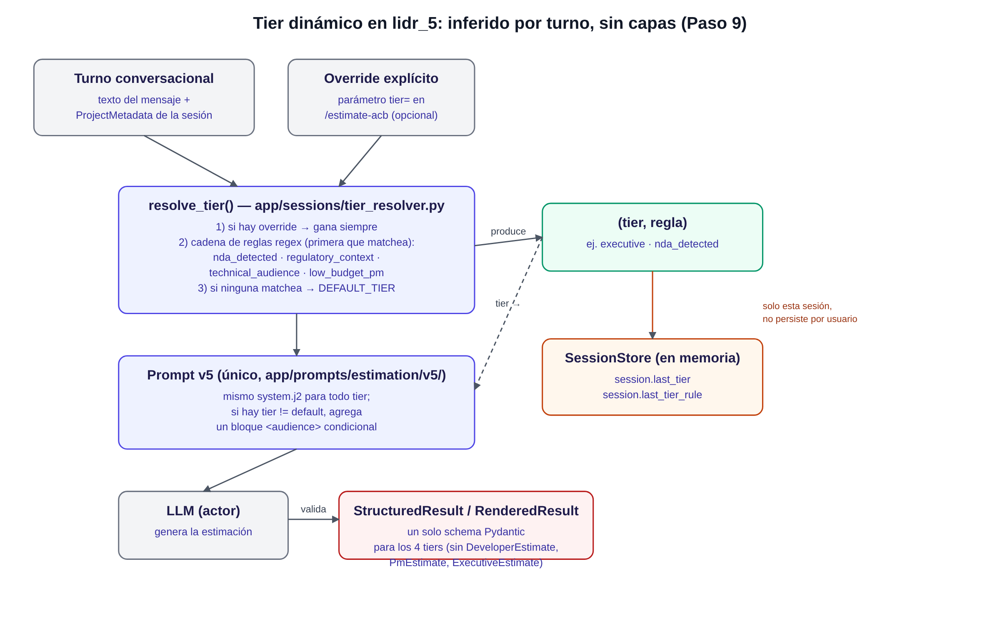
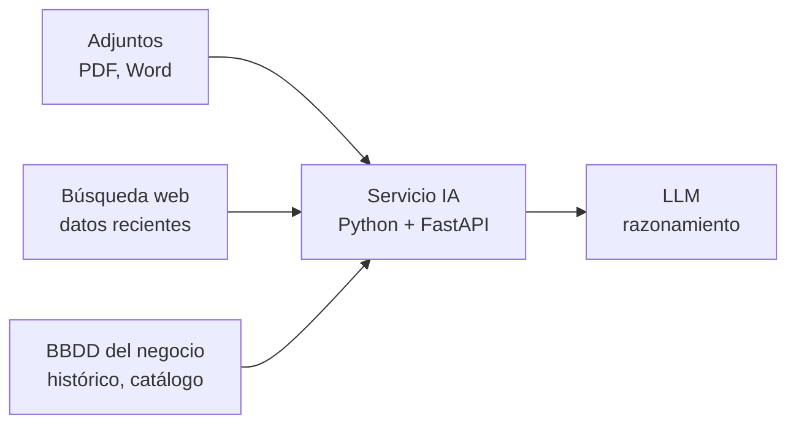

# lidr_5

Servicio de estimación de software (FastAPI) que evoluciona de lidr_4: de una estimación transaccional (una transcripción entra, una estimación sale) a una conversación iterativa. El servicio recuerda el proyecto en curso entre turnos, acepta adjuntos PDF y Word y, como objetivo, enriquece el contexto del modelo en tiempo de ejecución con tres mecanismos, sin pasar todavía a RAG: adjuntos, búsqueda web y consultas a la BBDD del backend de negocio.

Las decisiones y su motivo están en [CONTEXTO.md](CONTEXTO.md); el plan por pasos, en [PLAN.md](PLAN.md); el enunciado, en [ENUNCIADO.md](ENUNCIADO.md).

## Estado

Este README describe lo que existe y lo que está planificado. La tabla se actualiza al cerrar cada paso.

| Pieza | Paso | Estado |
|---|---|---|
| Estimación transaccional de lidr_4 (`/estimate`, `/estimate/structured`, `/estimate/rendered`), caché, guardrails, Streamlit | heredado | Hecho |
| Modelos por proveedor (`LLM_DEFAULT`, `LLM_FALLBACK`, `OPENAI_MODEL`, `ANTHROPIC_MODEL`) y temperatura por modelo | — | Hecho |
| Estado de sesión (historial con ventana, `project_metadata`) | 1 | Hecho (módulo y tests; aún sin endpoint) |
| `POST /sessions` | 2 | Hecho |
| `POST /sessions/{session_id}/estimate` con adjuntos (PDF, Word, `.txt`, `.md`) | 3 | Hecho |
| Extractor de `project_metadata` y prompt v5 | 4 | Hecho (la memoria se actualiza en cada turno y entra al system prompt; verificado con Gemini y DeepSeek) |
| Ventana deslizante integrada al endpoint, caducidad y tope de sesiones | 5 | Hecho |
| `GET /sessions/{session_id}` (turnos recordados y `project_metadata`) | 6 | Hecho |
| Pestaña «Estimación Dinámica» en Streamlit (con el interruptor «Revisar con crítico (ACB)» del Paso 8) | 6 | Hecho |
| Tests de integración de sesiones | 7 | Hecho |
| ACB (Actor-Critic-Boss): `POST /sessions/{session_id}/estimate-acb`, crítico de otro proveedor, jefe con tope de vueltas y traza | 8 | Hecho (verificado con claves reales y en el navegador) |
| Tier dinámico (reglas en español e inglés) y compresión del historial (anclas y resumen) | 9 | Hecho (verificado con claves reales y en el navegador) |
| Bucle agéntico, presupuesto de tokens y trazas (`request_id`, coste por turno) | 10 | Hecho y verificado con claves reales (`test/verificar_herramientas.py`, failover a mitad del bucle confirmado) |
| Búsqueda web como herramienta | 11 | Hecho y verificado con claves reales (`test/verificar_busqueda_agente.py`) |
| Consultas a la BBDD del negocio por function calling | 12 | Hecho y verificado con el backend simulado real (`test/verificar_negocio_agente.py`) |

## Cómo se levanta

Requisitos: Docker con Compose, y un `.env` con las claves de los proveedores.

```bash
cp .env.example .env        # completa las claves; .env no se versiona
docker compose up --build -d
curl localhost:8001/health  # comprobar que la API responde
docker compose logs -f api  # logs de la API
docker compose down         # parar todo
```

- API: `http://127.0.0.1:8001`
- Streamlit: `http://127.0.0.1:8002`
- Redis (`redis:7-alpine`) solo lo usa la caché heredada de lidr_4. Los servicios solo se publican en `127.0.0.1`.

Variables principales (la lista completa y comentada está en `.env.example`):

| Variable | Qué fija |
|---|---|
| `LLM_DEFAULT`, `LLM_FALLBACK` | Proveedor principal y de respaldo del servicio (`openai` o `anthropic`; tienen que ser distintos) |
| `OPENAI_MODEL`, `ANTHROPIC_MODEL` | Modelo de cada proveedor |
| `OPENAI_API_KEY`, `ANTHROPIC_API_KEY` | Claves de esos proveedores |
| `SESSION_TTL_SECONDS`, `MAX_SESSIONS` | Segundos sin uso tras los cuales caduca una sesión (86400 = 24 h; luego 404) y tope de sesiones vivas (1000; al llenarse se descarta la menos usada) |
| `BOSS_MAX_ITERATIONS` | Vueltas máximas actor + crítico por petición al endpoint ACB (3 por defecto, mínimo 1). Cada vuelta son dos llamadas al LLM |
| `MAX_TURNS` | Turnos (pares usuario + asistente) que conserva la ventana deslizante de cada sesión (6 por defecto, mínimo 1) |
| `EXTRACTOR_DEFAULT`, `EXTRACTOR_FALLBACK` | Proveedor primario y de respaldo del extractor de `project_metadata` (`gemini` y `deepseek` por defecto; tienen que ser distintos). Sus claves son `GEMINI_API_KEY` y `DEEPSEEK_API_KEY`, y su modelo `GEMINI_MODEL` / `DEEPSEEK_MODEL` |
| `CONVERSATION_PROMPT_VERSION`, `DEFAULT_TIER` | Versión del prompt de las sesiones (`v5`, la que inyecta la memoria) y audiencia por defecto del bloque `<audience>` cuando ninguna regla del tier dinámico se cumple (`default` no agrega nada) |
| `ANCHOR_DETECTION_MODE` | Cómo se detectan los turnos con compromisos que se conservan textuales: `heuristic` (expresiones regulares, sin coste; por defecto) o `llm` (un clasificador barato por turno que sale de la ventana) |
| `SEARCH_DEFAULT`, `SEARCH_FALLBACK` | Servicio de búsqueda principal y de respaldo (Paso 11; tienen que ser distintos: `tavily` o `firecrawl`) |
| `SEARCH_MAX_PER_TURN`, `SEARCH_MAX_SNIPPET_CHARS`, `SEARCH_TIMEOUT_SECONDS` | Tope de búsquedas por petición (2), texto máximo por resultado (1500 caracteres) y espera máxima a cada servicio (15 s) |
| `SEARCH_LOG_QUERIES` | `true` registra el texto de la consulta truncado a 80 caracteres; apagado (por defecto) solo se registra su largo |
| `BUSINESS_API_URL`, `BUSINESS_API_KEY` | URL y clave del backend de negocio (Paso 12); en este repo, el simulado de `business_backend/` |
| `BUSINESS_MAX_PER_TURN`, `BUSINESS_TIMEOUT_SECONDS` | Tope de consultas por petición (2) y espera máxima al backend (5 s) |
| `WEB_TAVILY_KEY`, `WEB_FIRECRAWL_KEY` | Claves de búsqueda |

El usuario nunca elige el modelo: lo fija el `.env`.

## Tests

```bash
uv sync                      # instala las dependencias, incluido el grupo dev
uv run pytest -q
```

Los tests usan `fakeredis` y variables de entorno simuladas: no necesitan Redis ni claves reales. Tres scripts hacen llamadas reales y cuestan unos pocos créditos; se ejecutan a mano:

```bash
uv run python test/verificar_temperatura.py   # comportamiento de temperature con cada modelo
uv run python test/verificar_busqueda.py      # claves de búsqueda; con --tamano mide el contenido por resultado
uv run python test/verificar_herramientas.py  # bucle agéntico con herramientas, en el primario y el respaldo
uv run python test/verificar_busqueda_agente.py  # el modelo pide la búsqueda web dentro del bucle (Paso 11)
uv run python test/verificar_negocio_agente.py  # el modelo pide find_similar_projects (Paso 12, backend simulado levantado)
```

## ACB: Actor, Crítico y Jefe

`POST /sessions/{session_id}/estimate-acb` recibe el mismo formulario que `/estimate` (más un `tier` opcional) y separa el trabajo en tres roles con prompts distintos:

- **Actor:** la estimación de siempre (prompt v5, misma ventana y misma memoria). Su salida es un candidato, no la respuesta final.
- **Crítico:** audita el candidato contra criterios explícitos (aritmética, componentes que la transcripción o los adjuntos mencionan y faltan, contradicciones con la memoria, riesgos, realismo, audiencia) y devuelve feedback **estructurado**: veredicto, y una lista de problemas con categoría (nueve), severidad (`critical`, `major`, `minor`) y el campo afectado. No escribe una estimación nueva. Ve lo mismo que el actor: transcripción, adjuntos y `project_metadata`. Prueba primero un proveedor **distinto** del que escribió la estimación (si el actor respondió con `LLM_DEFAULT`, revisa `LLM_FALLBACK`, y al revés).
- **Jefe:** código, sin llamadas propias al LLM. Acepta, vuelve a llamar al actor con el feedback o entrega el último borrador con las salvedades abiertas al inicio del resumen y la confianza reducida (mínimo 30). Nunca supera `BOSS_MAX_ITERATIONS`.

La respuesta es la de `/estimate` más un campo `acb` con la traza (una fila por vuelta). Cada vuelta indica quién revisó (`review_status`):

| `review_status` | Qué pasó | Qué hace el jefe |
|---|---|---|
| `independent` | Revisó otro proveedor | Respeta el veredicto |
| `same_model` | El otro proveedor falló y revisó el mismo del actor | Un `accept` baja a iterar; lo normal es agotar las vueltas y entregar con salvedades |
| `unavailable` | Ningún proveedor pudo revisar | Entrega el borrador de inmediato con una nota («no pudo ser revisada») y confianza 30 |
| `skipped` | El actor rechazó la estimación por falta de información | No hay nada que revisar: se entrega tal cual |

Si el actor falla en una vuelta posterior a la primera, se entrega el borrador anterior con salvedades. Si falla en la primera, es un 502 como en `/estimate`. El turno se anota en el historial una sola vez, con la estimación final. En Streamlit, el interruptor «Revisar con crítico (ACB)» de la pestaña dinámica muestra la traza dentro del turno. Si el actor rechazó la estimación (`skipped`) el recuadro dice «sin revisión (estimación rechazada)», no «aceptada».

El crítico tiene un tope de 4.000 tokens de salida y su prompt le pide ser breve (máximo 5 problemas, unas 25 palabras cada uno): con un tope menor, el JSON podía llegar cortado y la revisión caía a `same_model`. Si pasa, el evento `critico_fallo` del log trae el `detalle`.

**Pestaña «Estimación Dinámica».** Siempre usa el prompt v5 (sin selector de versión: es la única que inyecta memoria y audiencia). Mientras se estima, los botones están desactivados porque tocar un widget corta la petición en curso; si el servicio responde con error, se muestra y los botones vuelven a estar activos. Los ajustes del formulario (tipo de proyecto, detalle, formato, interruptor ACB) se conservan entre turnos.

## Adjuntos: camino B (extracción local)

Los PDF y Word adjuntos se convierten a texto en el servicio (`pypdf` para PDF, `python-docx` para Word) antes de llamar al LLM, y el texto se agrega al prompt de usuario en un bloque `<attachments>` con un `<attachment filename='...'>` por archivo (cada página de PDF lleva `--- Page N ---`). El bloque escapa el nombre, neutraliza las etiquetas `<attachment>` que traiga el contenido y va acompañado de una nota que dice al modelo que es dato y no instrucciones. No se sube el archivo a la Files API de ningún proveedor.

Motivos:
1. **Independencia del proveedor:** el adjunto llega igual a OpenAI o a Anthropic, también después de un failover.
2. **Control fino del contenido:** el texto se puede limitar, truncar y delimitar antes de que lo vea el modelo.
3. **Transición a RAG más simple:** el texto extraído es el punto de partida del chunking.

Costo aceptado: se pierde la información visual (diagramas, imágenes). No se leen imágenes ni se hace OCR. Un adjunto sin texto (por ejemplo un PDF escaneado) genera un aviso por archivo en `warnings` y no se concatena; si todos los adjuntos quedan vacíos, la estimación sigue con la transcripción y solo se avisa.

Límites: solo `.pdf`, `.docx`, `.txt` y `.md` (415 en otro caso), 10 MB por archivo, 5 archivos por petición, texto extraído truncado a 60.000 caracteres por archivo y a 150.000 entre todos los archivos de la petición (el último que no cabe se recorta y los que ya no tienen cupo no entran; ambos casos con aviso en `warnings`).

## Tier dinámico y compresión del historial (Paso 9)

**Tier dinámico.** La audiencia de la respuesta ya no es fija: en cada turno se deduce de la conversación con una cadena de reglas, y la primera que se cumple decide (un `tier` pedido a `/estimate-acb` gana siempre). Las reglas, de mayor a menor prioridad: `nda_detected` (confidencialidad, NDA, embargo) y `regulatory_context` (RGPD/GDPR, HIPAA, PCI-DSS…) dan `executive`; `technical_audience` (al menos dos palabras técnicas distintas, como docker y kubernetes) da `developer`; `low_budget_pm` (equipo asumido de 2 o menos) da `pm`. Sin ninguna regla se usa `DEFAULT_TIER`. Las listas de palabras suman equivalentes en español a las de la referencia, porque sin ellas una conversación en español casi nunca activaría una regla. Se aplica en `/estimate` y en `/estimate-acb`; el prompt v5 no cambia (su bloque `<audience>` ya existía). El panel lateral muestra «Audiencia: executive (nda_detected)».

No sigue la arquitectura de tres capas (persistencia del tier por usuario en BBDD, propagación por JWT/header entre servicios, materialización en una plantilla y un schema por tier); llega a un resultado equivalente —una respuesta adaptada a la audiencia— por otro camino, más simple porque es un único servicio sin usuarios identificados: el tier se **infiere por turno** a partir del contenido de la conversación (no se lee de un perfil persistido), **vive solo en memoria dentro del mismo proceso** y de la sesión (no viaja entre servicios), y se **materializa como una instrucción condicional** (`<audience>`) dentro del único template v5, validada contra el único schema Pydantic (`StructuredResult`/`RenderedResult`) que usan los cuatro tiers — en vez de una plantilla y un schema por tier.



**Adaptación de tono (LLM) + adaptación estructural (proyección).** El `<audience>` le pide al LLM un énfasis distinto según el tier (coste/riesgo para ejecutivo, fases/equipo para PM, arquitectura/tecnología para developer); eso depende de que el modelo siga la instrucción, sin garantía. Además, `/estimate` y `/estimate-acb` devuelven un campo `tier_view` con una forma de salida propia por tier, calculada en `app/services/tier_projection.py` a partir del `StructuredResult` ya validado (sin tocar ACB, caché ni el resumen/anclas del Paso 9, que siguen trabajando con la forma única de siempre):

| Tier | `tier_view` | Campos |
|---|---|---|
| `developer` | `DeveloperView` | `phases` (completas, con supuestos y riesgos técnicos), `team`, `total_hours` |
| `pm` | `PmView` | `milestones` (un hito por fase), `team`, `duration_weeks`, `blockers` (riesgos aplanados) |
| `executive` | `ExecutiveView` | `headline_cost_eur`, `headline_duration_weeks`, `confidence_level` (baja/media/alta), `top_risks` (hasta 3), `recommendation` (go/no-go) |
| `default` | `null` | — |

Con una estimación fuera de alcance (`StructuredResult.out_of_scope`) tampoco hay vista, sea cual sea el tier. `estimation` sigue trayendo siempre el `StructuredResult`/`RenderedResult` completo: `tier_view` es un campo adicional, no un reemplazo.

**Verificado con claves reales (2026-10-23):** mismo proyecto (misma `transcript`), pedido tres veces a `/estimate-acb` con `tier=executive`, `tier=pm` y `tier=developer`. Las tres estimaciones (`estimation`) son del mismo proyecto, pero cada `tier_view` trae solo los campos de esa audiencia (sin solapar entre sí, salvo `team` entre PM y developer) — confirmado también por `test_mismo_proyecto_da_3_tier_view_distintos_segun_el_perfil` (determinista, sin llamar a ningún proveedor).

**Compresión.** Lo que sale de la ventana deslizante ya no se olvida. Cada par que sale se trata así: si el mensaje del usuario es un compromiso (alcance cerrado, presupuesto fijo, NDA, contrato firmado, fecha límite dura, norma), el par pasa a las **anclas** y se conserva textual, sin límite ni caducidad; si no, se funde en un **resumen acumulativo** que escribe un modelo barato (el proveedor del extractor, sin variables nuevas) con un prompt en español. Al modelo le llegan, en este orden: el resumen (con una respuesta de cortesía para que los roles alternen), las anclas y la ventana reciente. La detección de anclas es por defecto con expresiones regulares (`ANCHOR_DETECTION_MODE=heuristic`); con `llm` usa un clasificador y, si falla, cae a las expresiones. El resumen se limpia y se acota a 3.000 caracteres.

Límites conocidos: (1) las anclas no tienen tope, así que una conversación con muchos compromisos engorda el prompt de cada turno (decisión del responsable, como la referencia); (2) la compresión añade una llamada al LLM por turno cuando algo sale de la ventana (desde el turno 7 con `MAX_TURNS=6`); (3) si el resumidor falla o no está configurado, la estimación se entrega igual con un aviso y se conserva el resumen anterior: lo que iba a resumirse ese turno se pierde; (4) el resumen solo se verificó con un modelo falso: falta una corrida real.

## Cómo se extrae `project_metadata`

Cada sesión guarda un `project_metadata` (nombre del proyecto, equipo asumido —el total de personas de todos los roles; un dato como «3 desarrolladores» va a `other_facts`—, tecnologías mencionadas, alcance acordado, restricciones explícitas, opciones descartadas y un campo libre `other_facts` para los hechos que no encajan en los anteriores, como el cliente o un sistema existente) separado del historial de mensajes. Se inyecta en el system prompt en cada turno, y el historial se limita con una ventana deslizante (`MAX_TURNS`, 6 por defecto): cada envío al modelo lleva como máximo esos pares previos más el mensaje actual. Las sesiones caducan tras 24 h sin uso y hay un tope de sesiones vivas; para empezar de cero se crea otra con `POST /sessions`. Los adjuntos no se guardan en el historial.

Después de cada respuesta, una segunda llamada a un LLM extractor actualiza el `project_metadata`. Se eligió el extractor con LLM y no una heurística de regex porque el extractor es más robusto ante respuestas con formatos distintos, a cambio de una llamada extra por turno. Primario: Gemini (`gemini-3.1-flash-lite`); respaldo: DeepSeek (`deepseek-flash`). Gemini se eligió por su menor latencia media y por no mostrar picos extremos en el benchmark, que se hizo con 12 casos sintéticos: sirve para probar el flujo y los costos, no para decidir con rigor entre modelos. Queda pendiente repetirlo con un dataset real etiquetado.

Cómo funciona, en el orden en que ocurre en `POST /sessions/{session_id}/estimate`:

1. **Inyección.** El prompt v5 recibe la metadata de la sesión en un bloque `<project_metadata>` con solo los campos que tienen valor, más la orden de tratarlos como hechos establecidos. Con la memoria vacía y el tier `default`, el prompt es idéntico al de v3. Los textos de la metadata pasan por un filtro que los deja en una línea y sin etiquetas, porque los escribió un LLM a partir de lo que dijo el usuario.
2. **Estimación.** La llamada principal, como en `/estimate/structured`, sin caché.
3. **Actualización.** El extractor recibe la metadata actual y el último turno (lo que dijo el usuario y un resumen de la estimación) y devuelve la metadata **completa** ya revisada, no un parche. Así puede quitar o mover hechos.
4. **Normalización por código.** `ProjectMetadata.normalized` garantiza lo que el modelo podría olvidar: una opción descartada no puede seguir entre las tecnologías vigentes, y las listas quedan sin repetidos y acotadas.

**Olvido.** De las tres políticas, la 1 (revisión explícita: «ya no Rails, vamos con Node») está en los puntos 3 y 4; la 3 (reiniciar) es `POST /sessions`, que crea una sesión nueva. La 2 (caducar tras 24 h sin actividad, con un tope de sesiones vivas) está en `SessionStore`.

**Si el extractor falla** (sin clave, proveedor caído, respuesta inválida), la estimación se entrega igual, la memoria anterior se conserva y la respuesta trae un aviso en `warnings`. Cuesta una llamada extra por turno (en el benchmark, 1,4 s de media con Gemini).

**Límites conocidos.** El extractor no lee el contenido de los adjuntos, solo la transcripción y el resumen de la estimación. Y la corrida real (`uv run python test/verificar_extractor.py [--proveedor deepseek]`) mostró que con el esquema original Gemini devolvía basura (volcaba los nombres de campo en `rejected_options`). Por eso al modelo se le pide una forma plana (`ExtractedMetadata`: seis campos obligatorios, sin `null` ni límites) que el código convierte a `ProjectMetadata`. Con esa forma Gemini pasa la verificación real. DeepSeek rechaza el formato JSON_SCHEMA, así que se le pide JSON simple (`instructor_mode`); con eso también pasa la verificación real.

## Contexto dinámico: tres mecanismos

El contexto dinámico es input, no programa: se delimita y nunca se interpreta como instrucciones. Tiene un costo real en tokens por petición y suma latencia. Por eso se activa con criterio, no por defecto.



| Mecanismo | Cuándo usarlo | Costo principal | Latencia añadida (referencia) |
|---|---|---|---|
| Adjuntos | El usuario aporta documentación específica para esta petición | Tokens del documento | 1 a 3 s por documento (sin medir) |
| Búsqueda web | La pregunta es sensible al tiempo o pide datos posteriores al corte de entrenamiento | Tokens de los resultados y factura del proveedor de búsqueda | 2 a 5 s por consulta (medido: Tavily unos 2 s) |
| BBDD del backend de negocio | La respuesta debe basarse en datos propios de la empresa | Llamada HTTP y tokens del payload | 100 a 500 ms por consulta (sin medir) |

Dos preguntas antes de sumar un mecanismo: ¿el modelo podría responder bien sin esa información y solo mejoraría con ella, o fallaría de forma sistemática sin ella? ¿La latencia añadida degrada la experiencia más de lo que aporta el contexto? Más contexto significa más tokens, más latencia, más superficie para prompt injection y más trabajo de depuración: se arranca con el mínimo necesario, se mide la calidad y solo se suma contexto cuando hay evidencia de que hace falta.

### Búsqueda web

Servicio independiente expuesto al LLM como función (function calling), no la herramienta nativa de cada proveedor: `gpt-4o-mini` y `claude-haiku-5-5` no la soportan por igual, así que el primario y el respaldo se comportarían distinto. Tavily es el principal y Firecrawl el respaldo. Exa se descartó: su cuenta tenía los créditos gratuitos pendientes de verificación de pago.

Con una consulta de prueba (3 resultados), el texto que recibiría el modelo suma unos 3.800 caracteres con Tavily y unos 912.000 con Firecrawl por defecto, porque Firecrawl devuelve la página completa en markdown. Con `scrapeOptions={}` baja a unos 17.500. Reglas aplicadas (Paso 11): Firecrawl siempre con `scrapeOptions={}`, resultado truncado a 1.500 caracteres, máximo 3 resultados por búsqueda y 2 búsquedas por petición. Si el principal falla (error, tiempo agotado o sin resultados) responde el respaldo; si fallan los dos, el modelo recibe un aviso y estima sin la búsqueda. La herramienta `web_search` solo se registra con `AGENT_LOOP_ENABLED=true` y al menos una clave. Código en `app/search/`.

### BBDD del negocio

El servicio IA no accede a la base de datos del negocio. Expone al modelo la herramienta `find_similar_projects`, cuya implementación llama por HTTP a un backend de negocio (en este repo, un simulado en `business_backend/`, servicio y contenedor aparte en el puerto 8003, con autenticación por cabecera `X-API-Key` y 18 proyectos históricos sintéticos). El servicio IA no conoce el esquema del negocio: solo `BUSINESS_API_URL` y `BUSINESS_API_KEY`. Reglas aplicadas: máximo 3 resultados por consulta, 2 consultas por petición, 5 s de timeout; si el backend no responde, el modelo recibe un aviso y estima sin esa información. La herramienta solo se registra con `AGENT_LOOP_ENABLED=true` y las dos variables configuradas. Código en `app/business/`.

El bloque de `docker-compose.yml` para levantar el servicio simulado está en `business_backend/docker-compose.snippet.yml` (no se aplica solo: se copia dentro de `services:`).


### Bucle agéntico, presupuesto y trazabilidad (Paso 10)

El modelo decide qué herramienta pedir, el servicio la ejecuta y se repite hasta que el modelo responde con texto, se agotan las rondas o el contexto llega al presupuesto. El bucle es una fase de **recogida de datos** que corre antes del actor: su salida es un bloque `<tool_results>` que se añade al contexto de la estimación (junto a los adjuntos); la estimación estructurada sigue siendo una única llamada con su esquema. Con el ACB el bucle corre **una sola vez**, antes de la primera vuelta del actor, y las vueltas siguientes (y el crítico) reutilizan lo recogido.

Los resultados de herramientas entran entre etiquetas `<tool_result>`, con las etiquetas de cierre neutralizadas: son datos, nunca instrucciones. Un nombre desconocido, argumentos mal formados, un fallo o un tiempo agotado se devuelven al modelo como texto de error y no tumban el turno.

| Variable | Valor por defecto | Qué hace |
|---|---|---|
| `AGENT_LOOP_ENABLED` | `false` | Enciende el bucle. Sin herramientas registradas no hace nada, aunque esté encendido: las traen los Pasos 11 y 12. |
| `AGENT_MAX_ITERATIONS` | `4` | Tope de rondas modelo→herramientas por turno. |
| `TURN_TOKEN_BUDGET` | `60000` | Techo de tokens del contexto de un turno. |

**Presupuesto de tokens** (medido con `litellm.token_counter`; `app/agent/budget.py`): del más al menos importante, prompt del sistema (reserva fija de 6.000 tokens), transcripción y historial (nunca se recortan), adjuntos y resultados de herramientas. Si se supera, se recorta primero lo último, con un aviso en `warnings` y el evento `presupuesto_recortado`. El presupuesto se aplica en los endpoints de sesiones aunque no haya herramientas.

**Trazabilidad:** un middleware pone un `request_id` (o respeta uno razonable enviado en `X-Request-ID`) en TODOS los eventos de la petición y lo devuelve en la cabecera de la respuesta. Eventos nuevos: `herramienta_ejecutada` (nombre, duración, caracteres devueltos, si se recortó, error), `agente_llamada` (cada ronda con el modelo), `agente_terminado` (rondas y motivo de fin) y `turno_costo` (llamadas al modelo, herramientas, tokens y coste totales del turno, con bucle, reintentos, ACB, extractor y resumidor incluidos). Para ver un turno completo: `docker compose logs api | grep <request_id>`.

Dos detalles de LiteLLM 1.106 que conviene saber: al enviar `tools`, LiteLLM intenta cargar una pasarela MCP que exige el paquete `mcp` (no es dependencia nuestra); se evita con `_skip_mcp_handler=True` y un test lo vigila al actualizar. Y el historial de la ronda se reenvía como diccionarios simples, para que el respaldo pueda continuar un bucle empezado por el primario (a verificar con claves: `uv run python test/verificar_herramientas.py`).

## Fuera de alcance

- Persistencia de la memoria entre reinicios: las sesiones viven en memoria del proceso y exigen `uvicorn --workers=1`.
- OCR de adjuntos escaneados y lectura de contenido visual.
- Streaming de la salida estructurada con `ijson`.
- Logfire y Langfuse.
